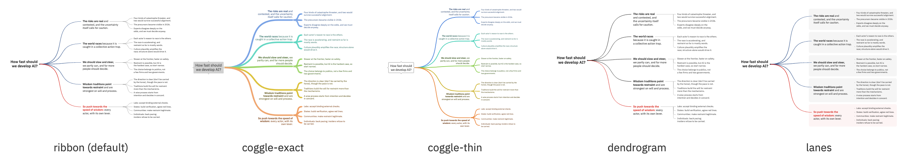
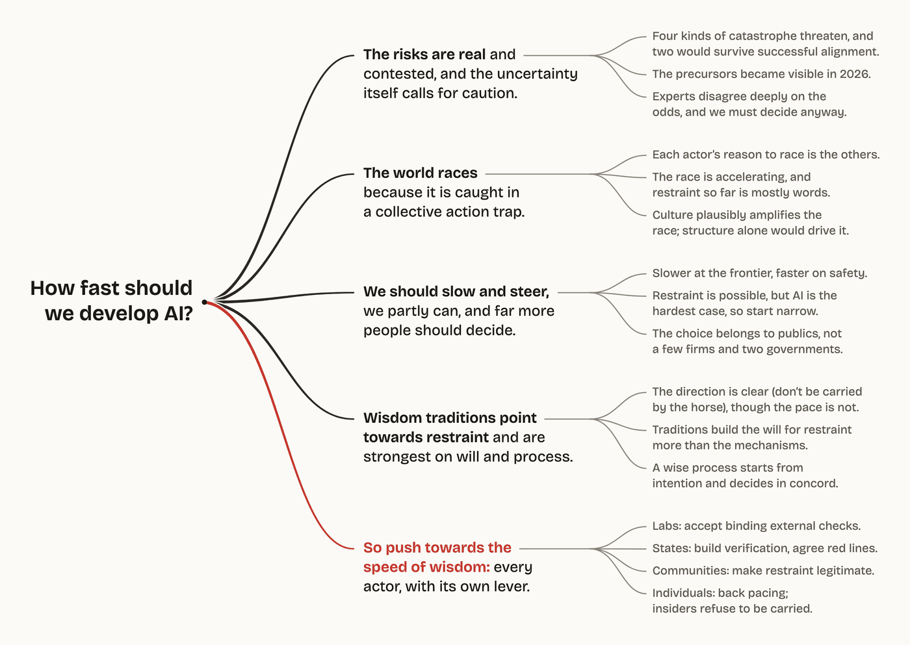
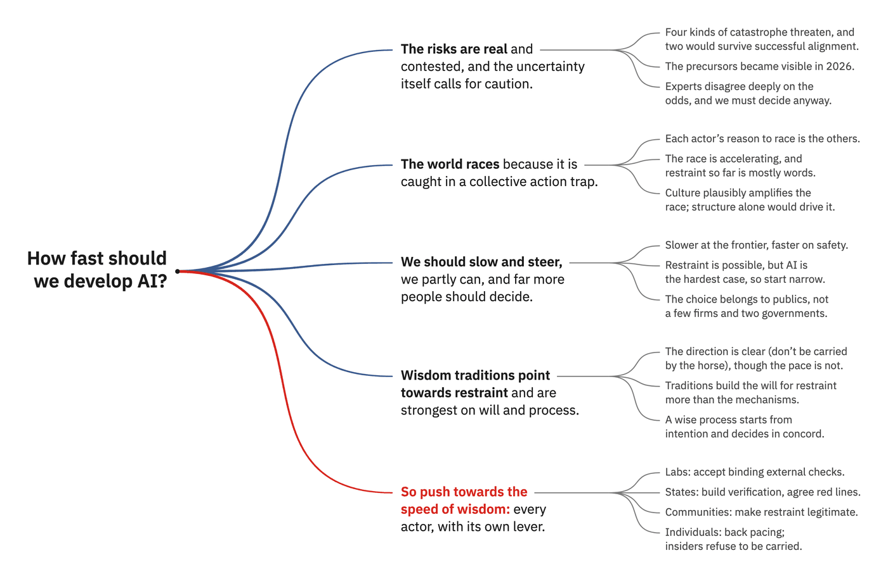
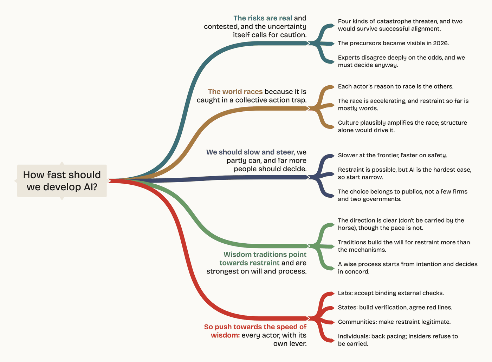
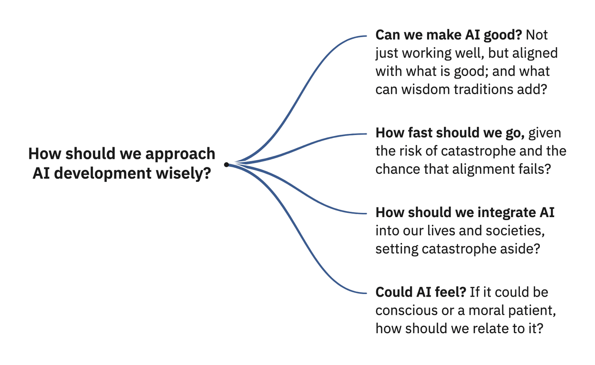

# Tree render

Tree render turns a nested bullet list into a clear, good-looking image you can put on a web page or share. It is for trees of thought: a question and its answers, an argument and its reasons, a plan and its parts. It also helps you tighten the words, so the tree reads at a glance.


Question trees, issue trees, hypothesis trees, argument maps and mind-map-style outlines are all trees of thought, and all render the same way.

## Try it

Needs Node 20 or later, and Chrome (for the PNG).

```bash
git clone --depth 1 https://github.com/reasoncommons/tree-render && cd tree-render/skills/tree-render/render
npm install
node bin/render.js ../../../examples/speed-of-wisdom.md --out out
```

That writes `out/speed-of-wisdom.png` and `out/speed-of-wisdom.svg`. No Chrome? Add `--no-png` and use the SVG.


## Gallery



Five styles: `ribbon` is the default; pick another with `--style`:

```bash
node bin/render.js ../../../examples/speed-of-wisdom.md --style coggle-exact --out out
```

Some useful variants: ribbon in a site's own palette and font, ribbon with Coggle's curves, Coggle's look in a print palette, and a one-level tree.

| Ink and seal | Coggle's curves | Coggle, print palette | One level |
| --- | --- | --- | --- |
| [](docs/gallery.md#ink-and-seal-the-wisdom-and-ai-site) | [](docs/gallery.md#coggles-curves) | [](docs/gallery.md#print-palette-with-bricolage) | [](docs/gallery.md#a-one-level-tree) |
| `--palette wise-ink --font bricolage` | `--curve coggle` | `--style coggle-exact --palette wise-print --font bricolage` | `--root-style centre` |

The [gallery](docs/gallery.md) shows every style and the main options on the same tree, each with the command that made it. `ribbon`, `dendrogram` and `lanes` draw their main branches with their own curve by default; `--curve coggle` gives Coggle's curve instead, over a run long enough to keep its soft corners (a little wider). They draw two levels below the root; for deeper trees use `coggle-exact`.

## Write your own tree

A tree is a Markdown file: an H1 title, then nested bullets indented two spaces. The first bullet is the root: usually a question, or a claim or goal. Put the opening words of each main point in bold: that is the lead, and read alone the leads should tell the argument.

```markdown
# Go at the speed of wisdom

- How fast should we develop AI?
  - **The risks are real** and contested, and the uncertainty itself calls for caution.
    - The precursors became visible in 2026.
    - Experts disagree deeply on the odds, and we must decide anyway.
  - **So push towards the speed of wisdom:** every actor, with its own lever.
    - Labs: accept binding external checks.
    - States: build verification, agree red lines.
```

The full example is [examples/speed-of-wisdom.md](examples/speed-of-wisdom.md). Good trees are short: 3–5 main points, 2–4 short points under each, two levels below the root. The [content guide](skills/tree-render/CONTENT-GUIDE.md) says how to get there from a long argument.

## Options

The most useful: `--style NAME`, `--palette wise-ink|wise-print` (other colours, with a red "So…" branch), `--font NAME`, `--depth N`, `--no-png`, `--out DIR`. See [SKILL.md](skills/tree-render/SKILL.md) for what each style is for and the main options, [TREE-FORMAT.md](skills/tree-render/render/TREE-FORMAT.md) for the input format (Markdown or JSON), and `node bin/render.js --help` for everything.

## No install: paste a prompt

Copy this into any AI chat (Claude, ChatGPT and others), then paste your tree, outline or notes at the end. It prepares the content and, if the AI can run code, renders the image.

```text
Turn my material (at the end) into a tree diagram using tree-render: https://github.com/reasoncommons/tree-render

1. CONTENT (always). Make a tree from my material, following https://github.com/reasoncommons/tree-render/blob/main/skills/tree-render/CONTENT-GUIDE.md. Compress my argument: never invent claims, drop qualifiers or change "should" to "does".
- Root: a plain question, 8 words or fewer. Under it, 3-5 main points (assertions, not topics), each with 2-4 short points (14 words or fewer). Two levels below the root.
- Each main point opens with a bold lead (6 words or fewer) that stands alone as the point, like a heading; the rest (12 words or fewer) qualifies it. Read alone, top to bottom, the leads tell the argument.
- If my material reaches a conclusion, make it the last main point, starting "So".
Output the tree as Markdown: an H1 title, then nested "- " bullets indented two spaces, the first bullet being the root, and **lead** in bold. Then list any wording you drafted rather than took from me.

2. RENDER, if you can run commands. Save the tree as tree.md, then:
  git clone --depth 1 https://github.com/reasoncommons/tree-render /tmp/tree-render
  cd /tmp/tree-render/skills/tree-render/render && npm install
  node bin/render.js /path/to/tree.md --out out
This writes out/tree.png and out/tree.svg. The PNG needs Chrome; without it, add --no-png and use the SVG. Exit code 1 means a branch crosses a label: shorten the text and render again, never shrink the type. Look at the image before showing it to me.

3. PREVIEW, if you can't run commands. Make one HTML page that draws the tree as SVG:
- Left to right; the root in a grey (#d0d0d0) box; each main point's branch a thick curve in its own colour (#7aa3e5 #67d7c4 #9ed56b #ebd95f #efa670 #e68782), its points on thinner curves in the same colour.
- Text in Arial; the bold lead at weight 700, the rest at 400; text in a darker shade of its branch.
- Measure text with canvas measureText to wrap lines and space nodes, so nothing overlaps.
- Exact numbers: https://github.com/reasoncommons/tree-render/blob/main/docs/design/references/coggle-spec.md
Label it a preview: the exact image comes from step 2.

My material:
```

## Use it from an AI agent

The repo includes a skill, [skills/tree-render](skills/tree-render/SKILL.md), that tells an agent how to prepare the content, render it and check the result. For Claude Code, after the steps in "Try it", link it into your skills folder (run this anywhere inside the clone):

```bash
ln -s "$(git rev-parse --show-toplevel)/skills/tree-render" ~/.claude/skills/tree-render
```

Or copy the folder there. Then ask your agent to "render this tree" and give it the tree or your notes. Other agents that read skills can use the same folder.

## Working on tree-render

Contributors and agents working on the renderer itself: start with [AGENTS.md](AGENTS.md). The design history is in [docs/design/](docs/design/), and work is tracked in Beads (`bd ready`).
