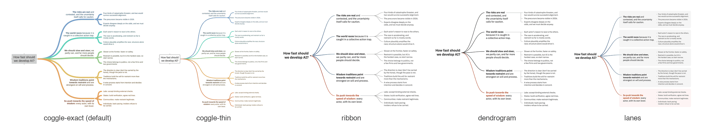

Tree render now draws question and hypothesis trees in five styles: Coggle (the default), a thin-line Coggle, ribbon, dendrogram and lanes. Branches never cross text, and trees come out about 10–15% narrower than Coggle's own while keeping its curves, thanks to a rule worked out from how Coggle shapes each branch. Palettes and fonts can match a host site; the Wisdom and AI trees will use ribbon in ink with one seal red. See the [README](https://github.com/reasoncommons/tree-render#readme): three commands to a PNG, and a prompt to paste into any chat if you'd rather not install anything.

