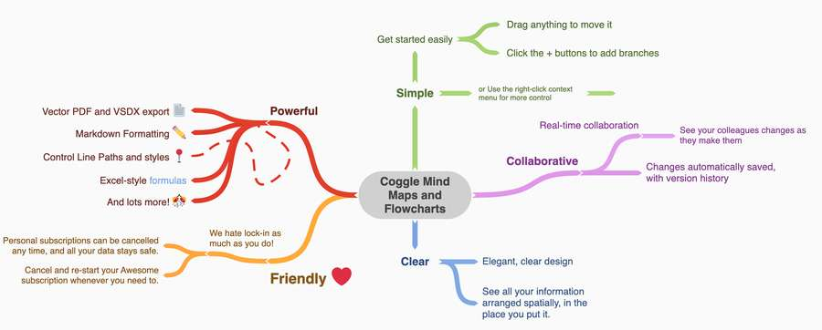
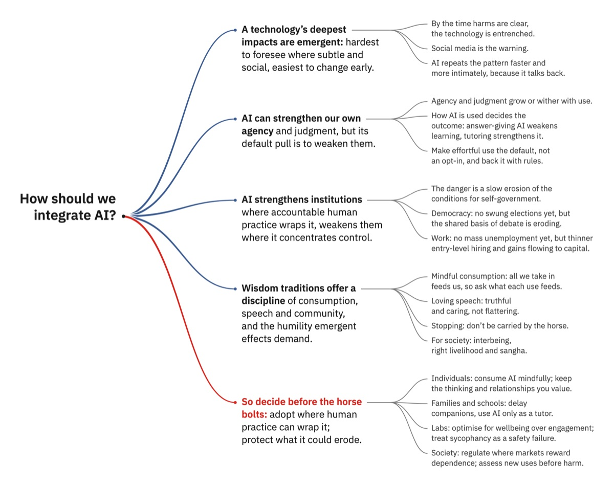
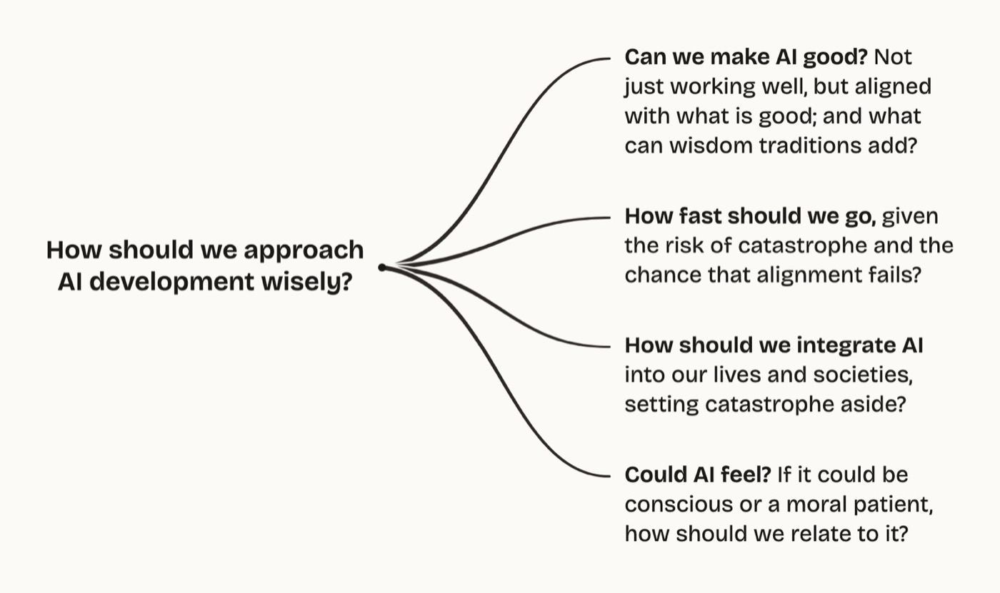

# From a rough cut to a menu: designing tree-render with AI

In October we had a very rough cut of a tree drawing: strong text, weak drawing. A month later we have a menu: five styles, each good for something, plus a set of tweaks for fonts, sizes, colours, the root and the curves. In between came a mood board, themed mock-ups, an exact copy of [Coggle](https://coggle.it), a dozen diagram directions, several font rounds and a rule for how branches should curve. This post is the story of that journey, from rough cut through real exploration to a menu, and what designing the look of [tree-render](../../README.md), a small tool that turns a question or hypothesis tree into an image you can share, taught us about information design and about doing design work with AI.

A note on "we". Almost all of the making was done by AI models (Claude Opus, Fable and Sonnet). I set the goal, looked at every round and said what was wrong. The verdicts quoted are mine, from the design log, typos included.

## Why trees

We use issue trees a lot: a question at the root, sub-questions beneath, and a hypothesis tree that mirrors it. Nested bullets are fine for editing and poor for reading, and nobody shares a screenshot of bullet points. So the question was: how can we reliably turn any tree into a visual that is good information design and compelling enough to share?

We split the job into two steps, as with slides: first the content (which nodes, at what depth, each worded as a bold lead and a lighter continuation), then the render. This post is mostly about the render, but the content mattered just as much.

## The journey

Every option, including the discards, is in the [design archive](../design/archive/index.html), and every verdict in the [design log](../design/design-log.md).

### 1. A rough cut

The first trees, from an earlier draft skill in October, were "the best so far": dark branches, one red branch for the conclusion, grey hairlines to the points. The text was strong ("**The world races** because it is caught in a collective action trap"). The drawing was weak, with branches too thin and not beautiful.

When we picked it up again in November I said: "Rather than just fixing that, you need to actually think about what you're trying to do." So we did.

### 2. Exploring wide: a mood board and three themes

The first step was a [mood board](../design/moodboard/sources.md): fourteen real captures of how other people draw trees, plus three anti-references. Coggle, MindNode, Whimsical, markmap, consulting issue trees, argument maps from Argdown and Kialo, hand-drawn Buzan mind maps; and, as what we did not want, Mermaid's default, a boxed Xmind template and Miro's templates. Each capture got a "take" and a "leave" note, with measurements: Coggle's branches go from 13 px to 9 px; MindNode tapers from about 6 px to 1.5 px. It is all on the [brief page](../design/brief-page/index.html).

From that came three themed designs, Paper, Garden and Slate, with each label on a "shelf" and the branch running under the text, as markmap and MindNode do. They were polished, and generic. Verdict: "Worse than v0.1." On branch-under-text: "it really doesn't work… it's hard to then see the branches."

### 3. Five options, then copying Coggle exactly

So we reset: the same v0.1 text for every option, side by side. Fable produced five parameter sets, from coggle-faithful through editorial and tufte to river. My verdict: "these look bad … nothing nearly as good as coggle and worse imo than v0.1 … can you start *exactly* copying coggle".

Two rounds "inspired by" Coggle had been worse in ways I could see but not name. So we copied it. The AI opened public Coggle diagrams in a headless browser, dumped every branch path, colour and text box, then found the formulas in Coggle's JavaScript bundle. (Coggle's code is not copied into the repo; the rules are restated in [coggle-spec.md](../design/references/coggle-spec.md) and reimplemented.) They reproduce Coggle's branch paths to four decimal places, and a test keeps it that way.

Verdict: "this is *much* better and we now have a good 'coggle' style."

It taught us a lot. Coggle's branches curve twice, in a full S with horizontal ends. Its colours are disciplined, and each label is a darker shade of its branch. We made one deliberate change: Coggle lets branches pass through other labels, softened by a white halo, but our sentences are longer than its usual labels, so for us no branch may cross a label, and the layout searches until nothing collides. When that made trees wide, I asked to "prefer more vertical space and less width", and the layout now leans tall.

### 4. Varying the diagram, not the fonts

Next I asked for more elegant styles. Fable proposed three, Hairline, Broadsheet and Letterpress: the same Coggle diagram with different fonts and pigments. My reaction: we're "not just doing font variation… the question was what options were there in terms of actual design of the diagram." One survived: Hairline, a thin-line Coggle, became coggle-thin.

The next brief required real variation in the diagram. Six directions came back: dendrogram "works well but a bit dry"; outline "useful when we just have a doc, but not engaging or shareable"; radial "does not work at all".

A second round gave four more. Option A was, in Fable's own description, the v0.1 pattern (one hue for the branches, red for the conclusion, grey hairlines to the points) now drawn as Coggle-style tapered ribbons. It kept what was strong in the rough cut and fixed what was weak. I liked it, along with a warmer dendrogram and "lanes, where the dots work better". Those three, plus the two Coggle styles, became the five styles. My verdict on the set: "We're getting there... we're now good", with Coggle still "by far the most beautiful".

### 5. Fonts, sizes and a rule for curves

Only then did we turn to type. Two rounds settled Arimo as the default (Bricolage on request; Merriweather terrible; monospace doesn't work at these sizes) and Coggle's own sizes as the best. The second round also tried a narrower "middle" layout. It looked wrong, and I could not say why: "The middle just doesn't look right… the curvature isn't right." I asked for the pattern of curvature to be worked out, not tuned per width.

The AI measured the whole family of Coggle's curves. The finding, in [coggle-curvature.md](../design/references/coggle-curvature.md): Coggle's control points grow with the branch's rise, so the tightest corner stays at about a third of the run whatever the branch's aspect. Our "middle" curve, hand-tuned on one tree, had broken this.

The rule: draw Coggle's own S over a shorter run shared by all the root's branches, then a straight tail under the label, with the run never shorter than 320 px. Verdict: "This is great." The v0.1 tree is now about 14% narrower, with Coggle's curves and no branch crossing text.

### 6. Real use: palettes, roots and curves

The first real application is a set of trees for the Wisdom and AI site. We made two palettes from the site: "ink" (paper, ink and one seal red) and "print" (from its woodblock print). Shown all the styles in both, I chose ribbon in ink and seal, with red used once, on the conclusion. We then tried the root four ways (on a dot, centred, in a box, outlined): centred on its dot, no box, was best. I have since tested ribbon with a few people, and it is now the default for Seeds of Renaissance.

The top-level questions also got fuller wording, since a one-level tree has nothing beneath a node to explain it: "**Can we make AI good?** Not just working well, but aligned with what is good; and what can wisdom traditions add?"

Last, we took the curvature lesson back to ribbon, dendrogram and lanes: `--curve coggle` draws their level-1 branches, and ribbon's hairlines, with Coggle's cubic. The [comparison](https://claude.ai/artifact/4vG9ZmUMsqrUdFZwBvh5f7) is up for review.

## The menu

We did not end with one answer. We ended with a menu, because different trees and different sites want different things.

| Style | Use it when |
| --- | --- |
| `coggle-exact` | You want colour: Coggle's look and curves, a hue per branch. The most beautiful, and the command-line default. |
| `coggle-thin` | The same layout, quieter: thin branches, outlined root. |
| `ribbon` | A host site's own palette, one accent for the conclusion. The rough cut, refined; my default for Seeds of Renaissance. |
| `dendrogram` | Print, or a sober look: dark curves, rounded elbows to the leaves. |
| `lanes` | Many leaves per branch: ribbon with each branch on a soft grey band. |

And the tweaks, most of which came out of a round above:

- **Fonts**: `--font` (each style has its own default; Arimo, Bricolage, Plex, Atkinson and others are embedded).
- **Sizes**: `--sizes` for the root, level 1, level 2 and deeper; Coggle's own are the default.
- **Palettes**: `--palette wise-ink` or `wise-print`, with a red accent on the "So…" branch.
- **Root**: `--root-style dot|centre|box|outline` in ribbon, dendrogram and lanes.
- **Curves**: `--curve coggle` in ribbon, dendrogram and lanes; `--root-run` and `--s-run` in the Coggle styles.
- **Depth**: `--depth N` to show only the top levels.

## What worked

These are our conclusions, not established findings. A [literature review](../research/2026-11-12-tree-presentation-research.md) found evidence for the parts (left-to-right beats radial, smooth paths beat elbows) but nothing on a tree of sentences as a shareable graphic.

**Start from a rough cut on real content.** v0.1 was crude, but it was a real tree with real sentences, and it gave every later round something to beat. Every round used the same text at the same scale, so "worse than v0.1" was a judgement you could make at a glance: compare like with like.

**Explore wide before narrowing, and vary the diagram.** The mood board, the themes and the six directions were wide. But options that differ only in typeface and colour feel like choice and are not. The rounds that varied the connector, the ink and the layout gave us three of our five styles. Fonts came last.

**Reproduce a known-good exactly to learn from it.** Copying Coggle gave us a baseline to judge against and made the AI's job concrete: match these numbers, not "make it beautiful". Much of what makes ribbon work (tapered curved branches, one hue and one accent, darker text, the curvature rule) came from that copy.

**Keep every option and its verdict.** It stops a rejected idea quietly coming back, it let us see that round-2 A was the rough cut drawn well, and it is what this post is written from.

**Look for rules, not per-case tuning.** "The curvature isn't right" was an intuition. It became a rule only when someone measured the whole family of curves.

**End with a menu, not a single answer.** Coggle-exact is the most beautiful; ribbon suits a site with its own palette; lanes handles many leaves. A menu with a line on when to use each is more useful than one winner.

**Test with real people.** My verdicts drove the rounds, but the Seeds of Renaissance default was set after I showed ribbon to a few people: a small test, but a different one from "which do I like best on a comparison page".

**Get the content right.** The best renderer cannot save a weak lead. The content guide now has the rule that took longest to articulate: "A lead must stand alone as the point, like a heading." "So every actor should push" fails; "Push towards the speed of wisdom" works.

## What the AI was good at, and where it went wrong

### Strengths

**Reverse-engineering.** Finding Coggle's formulas in a minified bundle and matching its output exactly is tedious, precise work. The AI did it in one session.

**Building and testing a lot, fast.** The renderer has 390 tests, and variants cost minutes.

**A separate model as critic, with limits.** Before I saw a round, Fable reviewed the renders. Its catches were real: trees unreadable when shrunk, a clipped line in one font, two reds clashing in a palette. But it missed the bigger errors: it reinforced the phone detour below, and it endorsed the "middle" curve before I rejected it. A critic briefed by the maker shares the maker's blind spots about what was asked.

### Weaknesses

**Drift to safe variation.** Asked for options, the AI's default was fonts and colours on the same diagram, until an explicit rule said otherwise.

**Drift to generic.** Given a fresh brief, the AI designed afresh and moved towards a generic "clean" look, rather than building on the rough cut I had already rated best.

**Inventing constraints.** I had said readability at small sizes matters. The AI read that as "phone" and built a fonts round in phone frames, at different scales, impossible to compare. My reply: "i didn't want a phone render… phone will just live with it… i never asked for phone stuff". The saved rule now: no unasked constraints; ask in one line first.

**Sloppy comparisons.** Images on one comparison page were scaled differently, so the comparison misled. In design review the presentation is the evidence.

### Who decides

The AI reviewer is a good filter, but not the judge. Fable and I disagreed several times (it wanted bigger points and no root triangles); my taste decided, and we recorded why.

The division of labour that worked:

- I decide taste and scope, and look at every round.
- Fable makes the key design calls and critiques renders, with short, focused briefs.
- Opus builds.
- Sonnet does the mechanical work: captures, conversions, the archive.

Important corrections went into saved rules ("explore the diagram, not fonts"; "no unasked constraints; compare at the same scale"), and they held in later rounds.

## What's next

- **The Wisdom and AI trees ship.** A [handover brief](../plans/2026-11-13-wise-ai-trees-brief.md) lets another session draw them, which also tests whether the tool and docs stand on their own.
- **Coggle's curves in ribbon.** `--curve coggle` exists. It suits shallow trees; on a two-level tree like Q2 the run is too short and the outer branches become pipes, so the next step is to apply the full curve rule (a longer run) and look again.
- **The default style.** The command line still defaults to coggle-exact; ribbon may take its place.
- **Easy install.** A single `npx` command, and a PNG path that does not need Chrome.

## Links

The comparison pages for the later rounds are published as claude.ai artifacts. They are private for now; I may make them public.

- [Five styles](https://claude.ai/artifact/M2kRH44N1Ci7zRy1s1YbLV)
- [Fonts and sizes](https://claude.ai/artifact/5uAwQ34AUDiEWa4AkCiwbr)
- [Curvature](https://claude.ai/artifact/WfhCgdsXe91qCevHZzsXzM)
- [Wisdom and AI mockups](https://claude.ai/artifact/Egai2sxXdFBFg3WBHBDvUW) (versions 1–3)
- [Ribbon with Coggle's curves](https://claude.ai/artifact/4vG9ZmUMsqrUdFZwBvh5f7)
- [Older full archive](https://claude.ai/artifact/Cgj6SM4cjY3e7ESeVkjBAo)

In the repository:

- [README](../../README.md): try it in three commands, or paste the no-install prompt.
- [Design archive](../design/archive/index.html) and [design log](../design/design-log.md): every round, every option, every verdict.
- [Mood board](../design/moodboard/sources.md) and [brief page](../design/brief-page/index.html): the captures we started from.
- [Coggle spec](../design/references/coggle-spec.md) and [Coggle curvature](../design/references/coggle-curvature.md): the reverse-engineered rules and the curvature analysis.
- [Content guide](../../skills/tree-render/CONTENT-GUIDE.md): how to prepare a tree's text before rendering.
