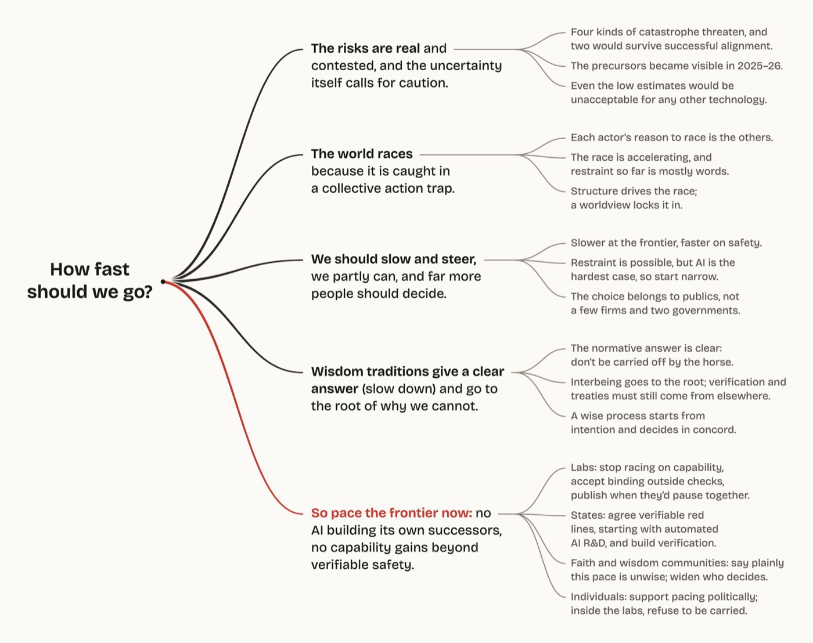
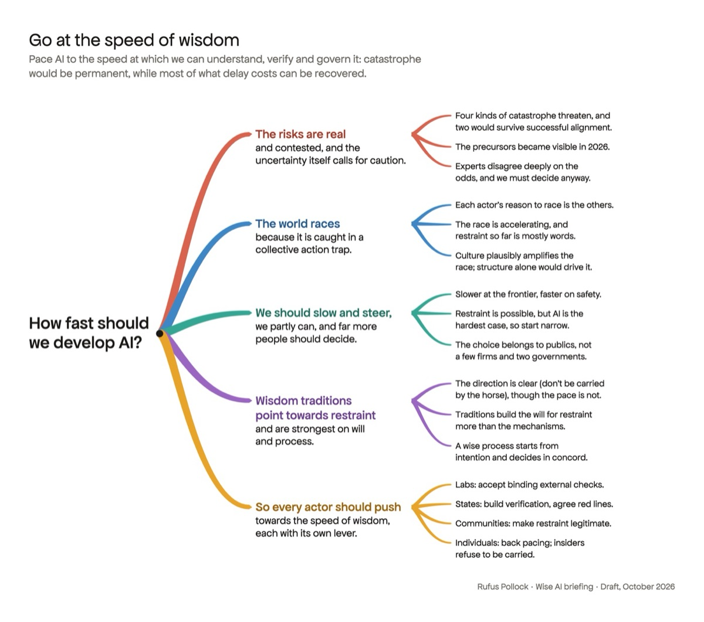
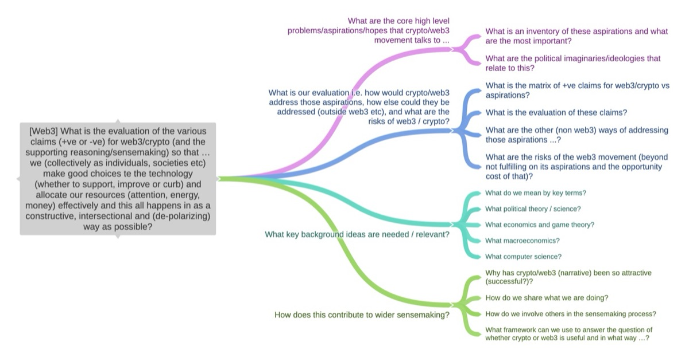
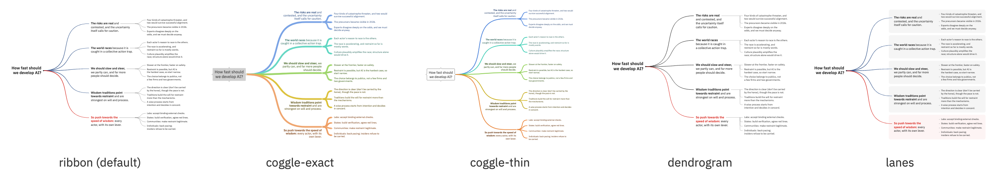
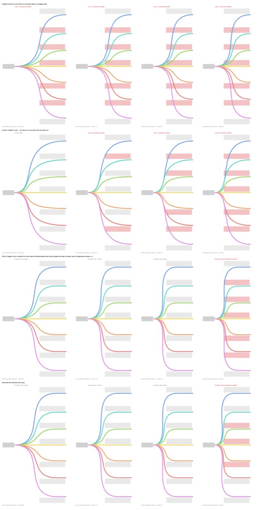

# Drawing trees with AI: the long way back to where we started

In October we had a first version of a tree drawing that I called "the best so far": dark branches, one red branch for the conclusion, grey hairlines to the points. Then we spent a month wandering away from it. We tried themed designs, five parameter sets and, most usefully, an exact copy of [Coggle](https://coggle.it). Then we came back to that first version, refined it, and it is now the style I use. This post is about that loop, and what designing the look of [tree-render](../../README.md), a small tool that turns a question or hypothesis tree into an image you can share, taught us about information design and about doing design work with AI.

A note on "we". Almost all of the making was done by AI models (Claude Opus, Fable and Sonnet). I set the goal, looked at every round and said what was wrong. The verdicts quoted are mine, from the design log, typos included.

## Why trees

We use issue trees a lot: a question at the root, sub-questions beneath, and a hypothesis tree that mirrors it with one assertion per node. Nested bullets are fine for editing and poor for reading: the first branch's sub-points push the second off the screen, and nobody shares a screenshot of bullet points. So the question was: how can we reliably turn any tree into a visual that is good information design and compelling enough to share?

We split the job into two steps, as with slides: first the content (which nodes, at what depth, each worded as a bold lead and a lighter continuation), then the render. This post is mostly about the render, but the content mattered just as much.

## The story in six beats

Every option, including the discards, is in the [design archive](../design/archive/index.html), and every verdict in the [design log](../design/design-log.md).

### 1. v0.1: strong text, weak drawing

The first trees, from an earlier draft skill in October, were "the best so far" for a specific reason: the text was strong ("**The world races** because it is caught in a collective action trap") and the drawing was weak, with branches too thin and not beautiful. Compare it with the image at the top of this post: same tree, same pattern, better drawing.

When we came back to it in November I said: "Rather than just fixing that, you need to actually think about what you're trying to do." That was right, but it also started the detour.

### 2. Wandering away

The first real design round produced three themes, Paper, Garden and Slate, with each label on a "shelf" and the branch running under the text, as markmap and MindNode do. It had wandered from what was already working towards a generic "clean" look. Verdict: "Worse than v0.1." On branch-under-text: "it really doesn't work… it's hard to then see the branches."

So we reset: the same v0.1 text for every option, side by side. Fable produced five parameter sets, from coggle-faithful to river. My verdict: "these look bad … nothing nearly as good as coggle and worse imo than v0.1 … can you start *exactly* copying coggle".

### 3. Reproducing Coggle exactly

Coggle had been the benchmark from the start, and two rounds "inspired by" it had been worse in ways I could see but not name. So we stopped being inspired and copied it.

The AI opened public Coggle diagrams in a headless browser, dumped every branch path, colour and text box, then found the formulas in Coggle's JavaScript bundle. (Coggle's code is not copied into the repo; the rules are restated in [coggle-spec.md](../design/references/coggle-spec.md) and reimplemented.) They reproduce Coggle's branch paths to four decimal places, and a test keeps it that way.

Verdict: "this is *much* better and we now have a good 'coggle' style."

It taught us a lot. Coggle's branches curve twice, in a full S with horizontal ends. Its colours are disciplined, and each label is a darker shade of its branch. We made one deliberate change: Coggle lets branches pass through other labels, softened by a white halo, but our sentences are longer than its usual labels, so for us no branch may cross a label, and the layout searches until nothing collides. Coggle-exact is still the better choice for colourful trees, and it stays a style.

### 4. Varying the diagram, and finding v0.1 again

Next I asked for more elegant styles. Fable proposed three: the same Coggle diagram with different fonts and pigments. My reaction: we're "not just doing font variation… the question was what options were there in terms of actual design of the diagram."

The next brief required real variation in the diagram. Six directions came back: dendrogram "works well but a bit dry"; outline "useful when we just have a doc, but not engaging or shareable"; radial "does not work at all".

A second round brought v0.1 back. Option A was, in Fable's own description, the v0.1 pattern: one hue for the branches, red for the conclusion, grey hairlines to the points, but now drawn as Coggle-style tapered ribbons. It fixed what was weak in v0.1 and kept what was strong. I liked it, along with a warmer dendrogram and lanes.

Option A became the ribbon style, one of the tool's five. My verdict on the set: "We're getting there... we're now good", with Coggle still "by far the most beautiful". The command-line default is still coggle-exact for now; that may change.

### 5. The curvature problem, and a rule

A fonts-and-sizes round settled Arimo (Bricolage on request) and Coggle's own sizes. It also tried a narrower "middle" layout. It looked wrong, and I could not say why: "The middle just doesn't look right… the curvature isn't right." I asked for the pattern of curvature to be worked out, not tuned per width.

The AI measured the whole family of Coggle's curves. The finding, in [coggle-curvature.md](../design/references/coggle-curvature.md): Coggle's control points grow with the branch's rise, so the tightest corner stays at about a third of the run whatever the branch's aspect. Our "middle" curve, hand-tuned on one tree, had broken this.

The rule: draw Coggle's own S over a shorter run shared by all the root's branches, then a straight tail under the label, with the run never shorter than 320 px. Verdict: "This is great." The v0.1 tree is now about 14% narrower, with Coggle's curves and no branch crossing text.

### 6. Back where we started, refined

The first real application is a set of trees for the Wisdom and AI site. We made two palettes from the site: "ink" (paper, ink and one seal red) and "print" (from its woodblock print). Shown the styles in both, I chose ribbon in ink and seal, with red used once, on the conclusion. That is v0.1's pattern, drawn properly. I have since tested it with a few people, and it is now the default for Seeds of Renaissance.

The four top-level questions also got fuller wording: a one-level tree has nothing beneath a node to explain it, and "Can we make AI good?" could mean working well rather than being aligned with the good. So now: "**Can we make AI good?** Not just working well, but aligned with what is good; and what can wisdom traditions add?"

## What worked

These are our conclusions, not established findings. A [literature review](../research/2026-11-12-tree-presentation-research.md) found evidence for the parts (left-to-right beats radial, smooth paths beat elbows, colour aids memory) but no study of presenting a tree of sentences as a shareable graphic.

**Keep the early version that works, and refine it.** v0.1 had the right pattern from the start; only its drawing was weak. "Rather than just fixing that" pushed us to think, which was good, but it also licensed throwing away what worked. Each time we wandered from v0.1 the verdict was "worse than v0.1". Write down what is good about it, and make every new option beat it.

**Detours are useful if you harvest them.** Copying Coggle exactly was not the destination, but it paid for itself. It gave us a known-good baseline to judge against, and it made the AI's job concrete: match these numbers, not "make it beautiful". And ribbon took a lot from it: tapered curved branches, colour discipline (one hue, one accent, darker text), the no-collision rule and the curvature study.

**Test with real people.** My verdicts drove the rounds, but the Seeds of Renaissance default was set after I showed ribbon to a few people: a small test, but a different one from "which do I like best on a comparison page".

**Vary the diagram, not the fonts.** Options that differ only in typeface and colour feel like choice but are not. The rounds that varied the connector, the ink and the layout gave us three of our five styles, ribbon among them.

**Compare like with like.** One variable at a time, at the same scale, on the same real tree. Using the v0.1 text in every round is what made the return to v0.1 visible.

**Keep every option, including the discards, with its verdict.** It stops a rejected idea quietly coming back, it let us see that round-2 A was v0.1 again, and it is what this post is written from.

**Look for the rule, not per-case tuning.** "The curvature isn't right" was an intuition. It became a rule only when someone measured the whole family of curves.

**Separate content from rendering, and get the content right.** The best renderer cannot save a weak lead. The content guide now has the rule that took longest to articulate: "A lead must stand alone as the point, like a heading." "So every actor should push" fails; "Push towards the speed of wisdom" works.

## What the AI was good at, and where it went wrong

### Strengths

**Reverse-engineering.** Finding Coggle's formulas in a minified bundle and matching its output exactly is tedious, precise work. The AI did it in one session.

**Building and testing a lot, fast.** The renderer has 390 tests, and variants that cost minutes meant we could try ideas and learn from their failure.

**A separate model as critic, with limits.** Before I saw a round, Fable reviewed the renders. Its catches were real: trees unreadable when shrunk, a clipped line in one font, two reds clashing in a palette. But it missed the bigger errors: it reinforced the phone detour below, and it endorsed the "middle" curve before I rejected it. A critic briefed by the maker shares the maker's blind spots about what was asked. The framing errors were caught by me.

### Weaknesses

**Drift to safe variation.** Asked for options, the AI's default was fonts and colours on the same diagram, until an explicit rule said otherwise.

**Drift from what worked.** Given a fresh brief, the AI designed afresh and moved towards a generic "clean" look, rather than starting from the version I had already rated best.

**Inventing constraints.** I had said readability at small sizes matters. The AI read that as "phone" and built a fonts round in phone frames, at different scales, impossible to compare. My reply: "i didn't want a phone render… phone will just live with it… i never asked for phone stuff". The saved rule now: no unasked constraints; ask in one line first.

**Sloppy comparisons and weak self-assessment.** Images on one comparison page were scaled differently, so the comparison misled. In design review the presentation is the evidence. And "looks right" from the model that made the image means little.

### Who decides

The AI reviewer is a good filter, but not the judge. Fable and I disagreed several times (it wanted bigger points and no root triangles), and my taste decided. We recorded these, so a later session knows the choice was deliberate.

The division of labour that worked:

- I decide taste and scope, and look at every round.
- Fable (a design model) makes the key design calls and critiques renders, with short, focused briefs rather than long open-ended runs.
- Opus (a strong coding model) builds.
- Sonnet does the mechanical work: captures, conversions, the archive.

Important corrections went into saved rules ("explore the diagram, not fonts"; "no unasked constraints; compare at the same scale"), and they held in later rounds.

## What's next

- **The Wisdom and AI trees ship.** A [handover brief](../plans/2026-11-13-wise-ai-trees-brief.md) lets another session draw them, which also tests whether the tool and docs stand on their own.
- **Coggle's curves in ribbon.** The curvature rule is in the two Coggle styles; ribbon, dendrogram and lanes have not had the same treatment. A ribbon mockup with Coggle's curves is in progress.
- **The default style.** The command line still defaults to coggle-exact; ribbon may take its place.
- **Easy install.** A single `npx` command, and a PNG path that does not need Chrome.

## Links

The comparison pages for the later rounds are published as claude.ai artifacts. They are private for now; I may make them public.

- [Five styles](https://claude.ai/artifact/M2kRH44N1Ci7zRy1s1YbLV)
- [Fonts and sizes](https://claude.ai/artifact/5uAwQ34AUDiEWa4AkCiwbr)
- [Curvature](https://claude.ai/artifact/WfhCgdsXe91qCevHZzsXzM)
- [Wisdom and AI mockups](https://claude.ai/artifact/Egai2sxXdFBFg3WBHBDvUW) (versions 1–3)
- [Older full archive](https://claude.ai/artifact/Cgj6SM4cjY3e7ESeVkjBAo)

In the repository:

- [README](../../README.md): try it in three commands, or paste the no-install prompt.
- [Design archive](../design/archive/index.html) and [design log](../design/design-log.md): every round, every option, every verdict.
- [Coggle spec](../design/references/coggle-spec.md) and [Coggle curvature](../design/references/coggle-curvature.md): the reverse-engineered rules and the curvature analysis.
- [Content guide](../../skills/tree-render/CONTENT-GUIDE.md): how to prepare a tree's text before rendering.
