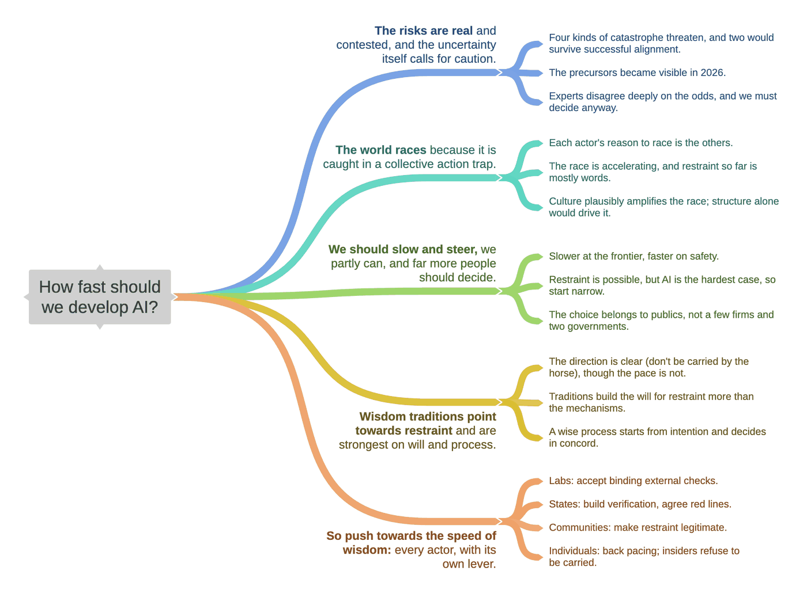
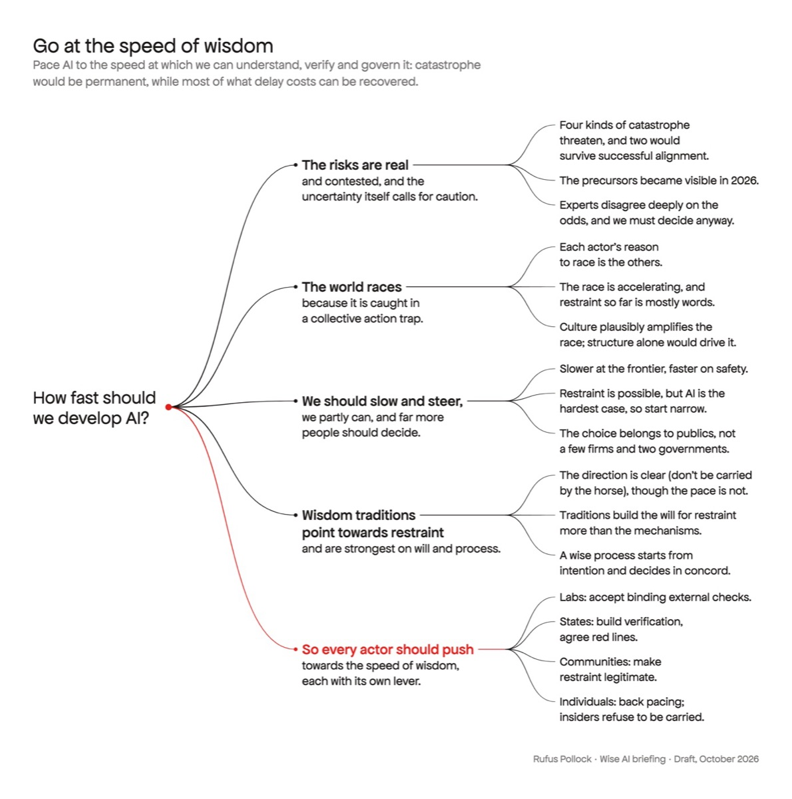
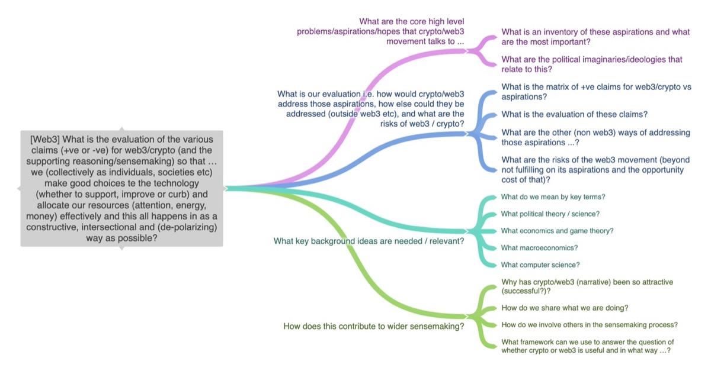
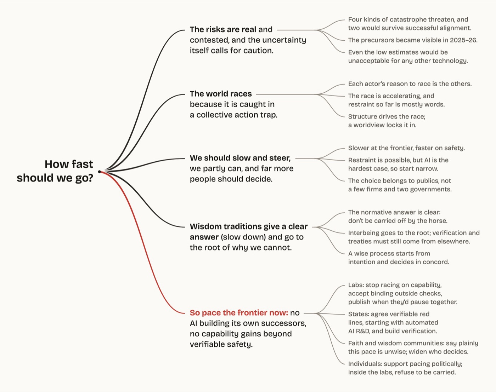

# Drawing trees with AI: what copying Coggle taught us

Two rounds of "inspired by Coggle" were worse than Coggle in ways I could see but not name. What finally worked was to stop being inspired and copy it exactly, down to the formula for each curve, and only then start to vary. That is the main lesson from designing the look of [tree-render](../../README.md), a small tool that turns a question or hypothesis tree into an image you can share. This post is about what we learnt, about information design and about doing design work with AI.

A note on "we". Almost all of the making was done by AI models (Claude Opus, Fable and Sonnet; more on who did what below). I set the goal, looked at every round and said what was wrong. The verdicts quoted are mine, copied from the design log, typos included.

## Why trees, and why Coggle

We use issue trees a lot: a question at the root, sub-questions beneath, and a hypothesis tree that mirrors it with one assertion per node. The default way to read one is nested bullets, which are fine for editing and poor for reading: the first branch's sub-points push the second off the screen, so the top-level shape gets lost. And nobody shares a screenshot of bullet points. So the question was: how can we reliably turn any tree into a visual that is good information design and compelling enough to share?

From the start there was a benchmark. [Coggle](https://coggle.it) draws trees with a colour per branch, thick curved branches and coloured text, and they are beautiful.

We split the job into two steps, as with slides: first the content (which nodes, at what depth, each worded as a bold lead and a lighter continuation), then the render. This post is mostly about the render, but the content mattered just as much.

## The story in six beats

Every option, including the discards, is in the [design archive](../design/archive/index.html), and every verdict in the [design log](../design/design-log.md).

### 1. v0.1: strong text, weak drawing

The first trees, from an earlier draft skill in October, were "the best so far" for a specific reason: the text was strong ("**The world races** because it is caught in a collective action trap") and the drawing was weak, with branches too thin and not beautiful. When we came back to it I said: "Rather than just fixing that, you need to actually think about what you're trying to do."

### 2. Inspired by Coggle, and worse than Coggle

The first real design round put each label on a "shelf" with the branch running under the text, as markmap and MindNode do. The brief and prototype were thorough, and the result had wandered from what was already working towards a generic "clean" look. Verdict: "Worse than v0.1." On branch-under-text: "it really doesn't work… it's hard to then see the branches."

So we reset: the same v0.1 text for every option, side by side, and an explicit list of what matters (font step-down, bold lead, colour per branch, thickness, taper, curvature, spacing). Fable produced five parameter sets, from coggle-faithful to river. My verdict: "these look bad … nothing nearly as good as coggle and worse imo than v0.1 … can you start *exactly* copying coggle". Coggle's branches curve twice, in a full S with horizontal ends; its colours are better; and each label is a darker shade of its branch.

### 3. Reproducing Coggle exactly

This was the turning point. The AI opened public Coggle diagrams in a headless browser, dumped every branch path, colour and text box, then found the formulas in Coggle's JavaScript bundle: control points, stroke width by level, text colour, spacing. (Coggle's code is not copied into the repo; the rules are restated in [coggle-spec.md](../design/references/coggle-spec.md) and reimplemented.) The restated formulas reproduce Coggle's branch paths to four decimal places, and a golden test keeps it that way.

Verdict: "this is *much* better and we now have a good 'coggle' style."

We made one deliberate deviation. Coggle lets branches pass through other labels, softened by a white halo; our sentences are longer than its usual labels, so for us no branch may cross a label, and the layout searches until nothing collides.

### 4. Varying the diagram, not the fonts

Next I asked for more elegant, refined styles. Fable proposed three, Hairline, Broadsheet and Letterpress, and all three were the same Coggle diagram with different fonts, weights and pigments. My reaction: we're "not just doing font variation… the question was what options were there in terms of actual design of the diagram."

The next brief required real variation in the diagram: at least one monochrome, one with no curves, one typographic. Six directions came back: dendrogram "works well but a bit dry"; outline "useful when we just have a doc, but not engaging or shareable"; radial "does not work at all". A second round kept a ribbon, a warmer dendrogram and lanes.

These became the tool's five styles, with coggle-exact the default. My verdict: "We're getting there... we're now good", with Coggle still "by far the most beautiful".

### 5. The curvature problem, and a rule

A fonts-and-sizes round settled Arimo as the default (Bricolage on request) and Coggle's own sizes. It also tried a narrower "middle" layout that did the climb before the label column. It looked wrong, and I could not say exactly why: "The middle just doesn't look right… the curvature isn't right." I asked for the pattern of curvature to be worked out, not tuned per width.

The AI measured the whole family of Coggle's curves across aspect ratios. The finding, in [coggle-curvature.md](../design/references/coggle-curvature.md), is simple once stated. Coggle's control points grow with the branch's rise, so the tightest corner stays at about a third of the run whatever the branch's aspect. A steeper branch does not get a tighter corner; it gets a longer near-vertical stretch in the middle. Our "middle" curve, hand-tuned on one tree, had broken this: a hook at the root, then a long straight diagonal.

The rule: draw Coggle's own S over a shorter run shared by all the root's branches, then a straight tail under the label, with the run never shorter than 320 px (the 240 px the analysis suggested turned steep branches into pipes). Verdict: "This is great." The v0.1 tree is now about 14% narrower than with Coggle's full run, with Coggle's curves and no branch crossing text.

### 6. Wisdom and AI: fitting a host site

The first real application is a set of trees for the Wisdom and AI site. Two palettes came from the site: "ink", from its paper, ink and one seal red, and "print", from its Yoshitoshi woodblock print. I chose ribbon in ink and seal, with red used once, on the conclusion. The root question sits centred on its dot. And the four top-level questions got fuller wording: a one-level tree has nothing beneath a node to explain it, and "Can we make AI good?" could mean working well rather than being aligned with the good. So now: "**Can we make AI good?** Not just working well, but aligned with what is good; and what can wisdom traditions add?"

## What worked

These are our conclusions, not established findings. A [literature review](../research/2026-11-12-tree-presentation-research.md) found evidence for the parts (left-to-right beats radial, smooth paths beat elbows, colour aids memory) but no study of presenting a tree of sentences as a shareable graphic.

**Anchor on an exact reproduction of something known to be good, then vary.** Reproducing Coggle gave us a baseline that was already good, and every later change could be judged against it. It also made the AI's job concrete: match these numbers, not "make it beautiful".

**Vary the diagram, not the fonts.** Options that differ only in typeface and colour feel like choice but are not. The "elegant" round offered three of those; the round that varied the connector (curves, elbows, braces, none), the ink and the layout gave us three of our five styles.

**One variable at a time, at the same scale, at actual size.** The fonts round in phone frames could not be compared because scale changed between images.

**Keep every option, including the discards, with its verdict.** It stops a rejected idea quietly coming back, and it is what this post is written from.

**Look for the rule, not per-case tuning.** "The curvature isn't right" was an intuition. It became a rule only when someone measured the whole family of curves. A hand-tuned curve that looks fine on one tree is a sign that the principle has not been found yet.

**Separate content from rendering, and get the content right.** The best renderer cannot save a weak lead. The content guide now has the rule that took longest to articulate: "A lead must stand alone as the point, like a heading." "So every actor should push" fails; "Push towards the speed of wisdom" works.

**Start from the real content.** Every round used real trees, never placeholder text. Collisions, width, dangling words and misleading one-level nodes only show up with real sentences.

## What the AI was good at, and where it went wrong

### Strengths

**Reverse-engineering.** Finding Coggle's formulas in a minified bundle and matching its output exactly is tedious, precise work. The AI did it in one session.

**Building and testing a lot, fast.** The renderer has 390 tests. Variants that cost minutes meant we could try the radial poster and the braces and learn from their failure.

**Turning an intuition into a rule.** I could see the middle curve was off; the AI measured what Coggle holds constant, and the rule followed.

**A separate model as critic, with limits.** Before I saw a round, Fable reviewed the renders. Its catches were real: depth-2 trees that became unreadable when shrunk, a clipped line in one font, the 240 px floor turning curves into pipes, two reds clashing in a palette. But it missed the bigger errors. It did not catch the phone detour; it reinforced it, recommending one-level trees on phones. And it endorsed the "middle" curve before I rejected it. A critic briefed by the maker shares the maker's blind spots about what was asked. The framing errors were caught by me.

### Weaknesses

**Drift to safe variation.** Asked for options, the AI's default was fonts and colours on the same diagram, until an explicit rule said otherwise.

**Inventing constraints.** I had said readability at small sizes matters. The AI read that as "phone" and built a fonts round with each font in a 390-pixel phone frame: small images, at different scales, impossible to compare. My reply: "i didn't want a phone render… phone will just live with it… i never asked for phone stuff". The saved rule now reads, in effect: no unasked constraints; if a new constraint seems to matter, ask in one line before building on it.

**Sloppy comparisons.** Depth was mixed into a font-size comparison; images on one comparison page were scaled differently, so the comparison misled; others ran off the page. In design review the presentation is the evidence.

**Weak self-assessment.** "Looks right" from the model that made the image means little. Once, the agreed critique step was skipped before showing me the work, and it showed.

**Process drift.** Over a long session, the AI's plan and mine diverged. At one point I asked: "when you make changes summarize here what you are going to do so we don't have confusion". Short written plans and explicit rules fixed this better than repeated correction.

### Who decides

The AI reviewer is a good filter, but not the judge. Fable and I disagreed several times in its written reviews, and my taste decided. Fable ranked Arimo above Bricolage and recommended 16 px points; I kept Arimo as the default, Bricolage on request and Coggle's own 22/15.3/13. Fable suggested dropping Coggle's root triangles; I like them. We recorded these rather than averaging them, so a later session knows the choice was deliberate.

The division of labour that worked:

- I decide taste and scope, and look at every round.
- Fable (a design model) makes the key design calls and critiques renders, with short, focused briefs rather than long open-ended runs.
- Opus (a strong coding model) builds.
- Sonnet does the mechanical work: captures, conversions, the archive.

Important corrections went into saved rules ("explore the diagram, not fonts"; "no unasked constraints; compare at the same scale"), and they held in later rounds.

## What's next

- **The Wisdom and AI trees ship.** A [handover brief](../plans/2026-11-13-wise-ai-trees-brief.md) lets another session draw them, which also tests whether the tool and docs stand on their own.
- **Curves for the other styles.** The curvature rule is in the two Coggle styles; ribbon, dendrogram and lanes have not had the same treatment.
- **Easy install.** A single `npx` command, and a PNG path that does not need Chrome.
- **A no-install prompt.** The README has a prompt to paste into any chat with your tree: it renders with the real tool if the chat can run code, and otherwise draws a preview from Coggle's rules.

## Links

The comparison pages for the later rounds are published as claude.ai artifacts. They are private for now; I may make them public.

- [Five styles](https://claude.ai/artifact/M2kRH44N1Ci7zRy1s1YbLV)
- [Fonts and sizes](https://claude.ai/artifact/5uAwQ34AUDiEWa4AkCiwbr)
- [Curvature](https://claude.ai/artifact/WfhCgdsXe91qCevHZzsXzM)
- [Wisdom and AI mockups](https://claude.ai/artifact/Egai2sxXdFBFg3WBHBDvUW) (versions 1–3)
- [Older full archive](https://claude.ai/artifact/Cgj6SM4cjY3e7ESeVkjBAo)

In the repository:

- [README](../../README.md): try it in three commands, or paste the no-install prompt.
- [Design archive](../design/archive/index.html) and [design log](../design/design-log.md): every round, every option, every verdict.
- [Coggle spec](../design/references/coggle-spec.md) and [Coggle curvature](../design/references/coggle-curvature.md): the reverse-engineered rules and the curvature analysis.
- [Content guide](../../skills/tree-render/CONTENT-GUIDE.md): how to prepare a tree's text before rendering.
