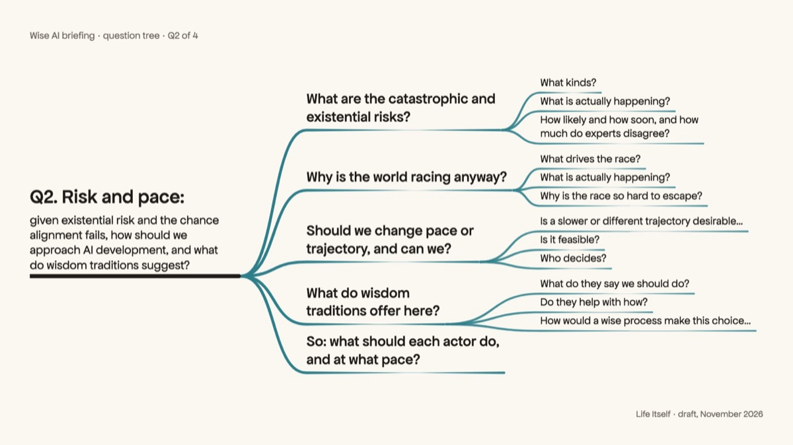

# What it took to get elegant rendering of trees of thought

*Even with AI, getting to good UX takes a surprising amount of effort.*


This is where we ended up: five ways to draw a tree of thought, each good for something, plus a handful of tweaks for fonts, sizes, colours, the root and the curves. Ribbon is now the default, drawn with curves borrowed from [Coggle](https://coggle.it).

And this is where we started, a bulleted list:

```markdown
- How fast should we develop AI?
  - **The risks are real** and contested, and the uncertainty itself calls for caution.
    - Four kinds of catastrophe threaten, and two would survive successful alignment.
    - Experts disagree deeply on the odds, and we must decide anyway.
  - **The world races** because it is caught in a collective action trap.
    - Each actor's reason to race is the others.
  - **We should slow and steer,** we partly can, and far more people should decide.
  - **So push towards the speed of wisdom:** every actor, with its own lever.
    - Labs: accept binding external checks.
    - States: build verification, agree red lines.
```

We use trees like this a lot: a question at the root, sub-questions or answers beneath. Nested bullets are fine for writing and editing. They're poor for reading, and nobody shares a screenshot of bullet points. So the goal of [tree-render](../../README.md) is simple to state: turn any tree like this into a picture that is good information design and nice enough to share.

Getting from the list to the menu took a month and about a dozen design rounds. Almost all the making was done by AI (Claude Opus, Fable and Sonnet). What it couldn't do well was tell good from bad. Again and again the AI produced something competent, generic and slightly wrong, and it took me looking and saying "no, worse" (often without being able to say why at first) to move things forward. So this post is partly about drawing trees, and partly about what it's like to do design work with AI right now. My short answer: AI seems to struggle with taste, and getting to something good and reusable was an iterative, collaborative slog, even with models this capable.

A note on "we". I set the goal, looked at every round and said what was wrong. The verdicts quoted are mine, from the [design log](../design/design-log.md), typos included.

## The journey

Every option, including the discards, is in the [design archive](../design/archive/index.html).

### 1. A rough render (v0.1)


The first render came in October from an early draft skill. It was the best we'd had: dark branches, one red branch for the conclusion, grey hairlines to the points. The text was strong. The drawing was weak, with branches too thin and nothing you'd call beautiful.

When I picked it up again in November I told the AI: "Rather than just fixing that, you need to actually think about what you're trying to do." So we went wide.

### 2. A mood board and three themes


The [mood board](../design/moodboard/sources.md) has fourteen real captures of how other people draw trees: Coggle, MindNode, Whimsical, markmap, consulting issue trees, argument maps from Argdown and Kialo, hand-drawn Buzan mind maps. Plus three things we didn't want, such as Mermaid's default. Each got a "take" and a "leave" note, with measurements (Coggle's branches go from 13 px to 9 px). It's all on the [brief page](../design/brief-page/index.html).



From that the AI made three themes, Paper, Garden and Slate, with each label sitting on a "shelf" and the branch running under the text, as markmap and MindNode do. They were polished and generic. My verdict: "Worse than v0.1." On branch-under-text: "it really doesn't work… it's hard to then see the branches."

This was the first sign of a pattern. Given a fresh brief, the AI designed from scratch and drifted towards a clean, safe look, instead of building on the rough render I'd already said was best.

### 3. Copying Coggle exactly

So we reset, with the same v0.1 text for every option, side by side at the same scale. Fable produced five parameter sets, from "coggle-faithful" to "river". I wrote back: "these look bad … nothing nearly as good as coggle and worse imo than v0.1 … can you start *exactly* copying coggle".


Two rounds "inspired by" Coggle had been worse in ways I could see but not name. Copying was the way out. The AI opened public Coggle diagrams in a headless browser, dumped every branch path, colour and text box, then found the formulas in Coggle's minified JavaScript. (No Coggle code is in the repo; the rules are restated in our own words in [coggle-spec.md](../design/references/coggle-spec.md) and reimplemented.) Our version matches Coggle's branch paths to four decimal places, and a test keeps it that way.

Verdict: "this is *much* better and we now have a good 'coggle' style."

This is where AI was at its best: tedious, exact work, done in one session. It taught us a lot. Coggle's branches curve twice, in a full S with flat ends. Its colours are disciplined, and each label is a darker shade of its branch. We changed one thing on purpose: our sentences are longer than Coggle's labels, so no branch may cross a label. That made trees wide, so I asked to "prefer more vertical space and less width".

### 4. Varying the diagram, not the fonts

Next I asked for more elegant styles. Fable came back with Hairline, Broadsheet and Letterpress: the same Coggle diagram in different fonts and pigments. I pushed back that we're "not just doing font variation… the question was what options were there in terms of actual design of the diagram." Only Hairline survived, as coggle-thin.

So the next brief required real variation in the drawing itself. Six directions came back. Dendrogram "works well but a bit dry". Outline is "useful when we just have a doc, but not engaging or shareable". Radial "does not work at all".


A second round gave four more. Option A was, in Fable's own description, the v0.1 pattern (one hue for the branches, red for the conclusion, grey hairlines to the points) drawn as Coggle-style tapered ribbons. The rough render, done properly. I liked it, along with a warmer dendrogram and "lanes, where the dots work better". Those three plus the two Coggle styles became the five. My verdict on the set: "We're getting there... we're now good", with Coggle still "by far the most beautiful".

### 5. Fonts, sizes and a rule for curves

Only then did we turn to type. Two rounds settled Arimo as the default (Bricolage on request; Merriweather looked terrible; monospace doesn't work at these sizes), with Coggle's own text sizes.

One fonts round went sideways. I'd said readability at small sizes mattered. The AI read that as "phone" and rendered everything in phone frames at different scales, which made the fonts impossible to compare. I wrote: "i didn't want a phone render… phone will just live with it… i never asked for phone stuff". Fable, reviewing the round as critic, had backed the phone idea too.

The second round also tried a narrower "middle" layout. It looked wrong and I couldn't say why: "The middle just doesn't look right… the curvature isn't right." The curve had been hand-tuned on a single tree, and Fable had signed it off. I asked for the pattern of curvature to be worked out properly instead of tuned per width.

The AI then measured the whole family of Coggle's curves ([coggle-curvature.md](../design/references/coggle-curvature.md)). Coggle's tightest bend stays at about a third of the run whatever the branch's shape. The hand-tuned curve broke that.


The new rule draws Coggle's own S over a shorter run shared by all the root's branches, then a straight tail under the label, with the run never under 320 px. "This is great." The v0.1 tree is now about 14% narrower, with Coggle's curves and no branch crossing text.

### 6. Real use: Wisdom and AI


The first real use is a set of trees for the Wisdom and AI site. We made two palettes from the site: "ink" (paper, ink and one seal red) and "print" (from its woodblock print). Looking at every style in both, I chose ribbon in ink and seal, with red used once, on the conclusion. We tried the root four ways (on a dot, centred, in a box, outlined); centred on its dot, with no box, was best. I've since shown ribbon to a few people, and it's now the default for Seeds of Renaissance too.

Real use also changed the content. A one-level tree has nothing underneath a node to explain it, so the top-level questions got fuller wording: "**Can we make AI good?** Not just working well, but aligned with what is good; and what can wisdom traditions add?"

Last, we took the curvature lesson back to ribbon, dendrogram and lanes: `--curve coggle` draws their first-level branches, and ribbon's hairlines, with Coggle's cubic. The first try squeezed tall trees into pipes, because ribbon's branches were too short for the curve rule; with the run lengthened to at least 320 px (about 100 px wider) the curves came right, and that is now ribbon's default ([comparison](https://claude.ai/artifact/4vG9ZmUMsqrUdFZwBvh5f7)).

## The menu


We didn't end with one answer. Different trees and different sites want different things, so we ended with a menu.

| Style | Use it when |
| --- | --- |
| `ribbon` | You want a host site's own palette, with one accent for the conclusion. The rough render, refined. The default. |
| `coggle-exact` | You want colour: Coggle's look and curves, a hue per branch. The most beautiful. |
| `coggle-thin` | You want the same layout, quieter: thin branches, an outlined root. |
| `dendrogram` | It's for print, or you want a sober look: dark curves, rounded elbows to the leaves. |
| `lanes` | There are many leaves per branch: ribbon with each branch on a soft grey band. |

The tweaks, most of which came out of one of the rounds above:

- `--font` sets the typeface. Each style has its own default; Arimo, Bricolage, Plex, Atkinson and others are embedded.
- `--sizes` sets text sizes for the root, level 1, level 2 and deeper. Coggle's are the default.
- `--palette wise-ink` or `wise-print`, with a red accent on the "So…" branch.
- `--root-style dot|centre|box|outline` in ribbon, dendrogram and lanes.
- `--curve coggle` in ribbon, dendrogram and lanes; `--root-run` and `--s-run` in the Coggle styles.
- `--depth N` shows only the top levels.

## What worked

These are our own conclusions. A [literature review](../research/2026-11-12-tree-presentation-research.md) found evidence for some parts (left-to-right beats radial, smooth paths beat elbows) and nothing on a tree of sentences as a shareable graphic.

Start from a rough render on real content. v0.1 was crude, but it was a real tree with real sentences, and every later round had to beat it. Using the same text at the same scale each time meant "worse than v0.1" was something you could judge at a glance.

Go wide before narrowing, and make the options differ in the drawing. Options that differ only in typeface and colour feel like a choice and aren't one. The rounds that changed the connectors, the ink and the layout gave us three of our five styles. Fonts came last.

Copy a known-good design exactly. Copying Coggle gave us a baseline and gave the AI a concrete job ("match these numbers") in place of "make it beautiful". Much of what makes ribbon work (tapered curves, one hue and one accent, darker text, the curvature rule) came out of that copy.

Keep every option and its verdict. It stops rejected ideas creeping back, and it's how we noticed that round-2 option A was the rough render drawn well.

Look for rules. "The curvature isn't right" was a hunch. It became something reusable only once the AI measured the whole family of curves.

Show it to other people. My verdicts drove the rounds, but the Seeds of Renaissance default came after I showed ribbon to a few people.

Get the content right. A good renderer can't save a weak lead. The [content guide](../../skills/tree-render/CONTENT-GUIDE.md) now has the rule that took longest to put into words: "A lead must stand alone as the point, like a heading." "So every actor should push" fails; "Push towards the speed of wisdom" works.

## What AI was good and bad at

The AI was excellent at the precise, checkable work. It found Coggle's formulas in a minified bundle. It built a renderer with 390 tests, so a new variant cost minutes. As a critic, Fable caught real problems before I saw a round: trees unreadable when shrunk, a clipped line in one font, two reds clashing in a palette.

Where it struggled was taste and judgement. Four things kept happening:

- Asked for options, it varied fonts and colours on the same diagram, until a saved rule said otherwise.
- Given a fresh brief, it drifted to a generic clean look and dropped what was already working.
- It invented constraints, like the phone frames.
- It made sloppy comparisons, with images on one page scaled differently. In design review the presentation is the evidence, so this misled.

The critic didn't fix these. Fable backed the phone detour and approved the hand-tuned curve. A critic briefed by the maker tends to share the maker's blind spots about what was actually asked.

## Who decides

The AI reviewer is a useful filter. It isn't the judge. Fable and I disagreed several times (it wanted bigger points and no root triangles), my eye decided, and we wrote down why.

The split that worked: I decide taste and scope and look at every round. Fable makes the key design calls and critiques renders, with short focused briefs. Opus builds. Sonnet does the mechanical stuff (captures, conversions, the archive).

The corrections that mattered went into saved rules: "explore the diagram, not fonts"; "no unasked constraints; compare at the same scale". They held in later rounds. Some of the lessons also went back into my general [designing-look-and-feel skill](https://github.com/life-itself/skills/blob/main/skills/designing-look-and-feel/SKILL.md). It sets out the cycle I now use for any design work (brief, research, mood boards, two or three mockups side by side, I pick, build, then go back to mood boards or mockups if real use shows a problem), plus traps to watch for, like one criterion taking over.

## What's next

- Ship the Wisdom and AI trees. A [handover brief](../plans/2026-11-13-wise-ai-trees-brief.md) lets another session draw them, which also tests whether the tool and docs stand on their own.
- Three-level trees in ribbon, dendrogram and lanes. They draw two levels today; a third needs its own column and smaller sizes further down.
- Easy install: a single `npx` command, and a PNG path that doesn't need Chrome.

## Links

The comparison pages for the later rounds are claude.ai artifacts. They're private for now; I may make them public.

- [Five styles](https://claude.ai/artifact/M2kRH44N1Ci7zRy1s1YbLV)
- [Fonts and sizes](https://claude.ai/artifact/5uAwQ34AUDiEWa4AkCiwbr)
- [Curvature](https://claude.ai/artifact/WfhCgdsXe91qCevHZzsXzM)
- [Wisdom and AI mockups](https://claude.ai/artifact/Egai2sxXdFBFg3WBHBDvUW) (versions 1–3)
- [Ribbon with Coggle's curves](https://claude.ai/artifact/4vG9ZmUMsqrUdFZwBvh5f7)
- [Older full archive](https://claude.ai/artifact/Cgj6SM4cjY3e7ESeVkjBAo)

In the repository:

- [README](../../README.md): try it in three commands, or paste the no-install prompt.
- [Design archive](../design/archive/index.html) and [design log](../design/design-log.md): every round, option and verdict.
- [Mood board](../design/moodboard/sources.md) and [brief page](../design/brief-page/index.html): the captures we started from.
- [Coggle spec](../design/references/coggle-spec.md) and [Coggle curvature](../design/references/coggle-curvature.md): the reverse-engineered rules and the curvature analysis.
- [Content guide](../../skills/tree-render/CONTENT-GUIDE.md): how to prepare a tree's text before rendering.
