# Gallery

Tree render draws a nested bullet list, a tree of thought, as an image. This page shows every style and the main options on one tree ([examples/speed-of-wisdom.md](../examples/speed-of-wisdom.md)) so you can compare them. Under each image is the command that made it, run from `skills/tree-render/render/` (it writes `out/<name>.png` and `.svg`). The images are regenerated by `python3 skills/tree-render/render/scripts/gallery.py`; the README's before/after image by `scripts/hero.py` beside it.

Pick a style first, then a palette (`--palette`) and font (`--font`) if you need to match a site. [SKILL.md](../skills/tree-render/SKILL.md) lists every option.

## Ribbon (the default)

Bold root on a dot, tapered ribbons to each main point, hairlines to its short points. Use it for most trees; it takes a host site's palette well.

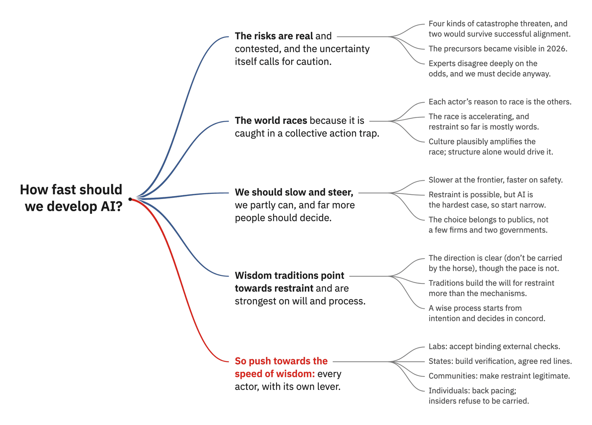

```bash
node bin/render.js ../../../examples/speed-of-wisdom.md --out out
```

### Ink and seal (the Wisdom and AI site)

Ink ribbons and warm-grey hairlines on paper, seal red once on the conclusion, text in Bricolage Grotesque. Use it on the Wisdom and AI site, or as a model for matching any site.

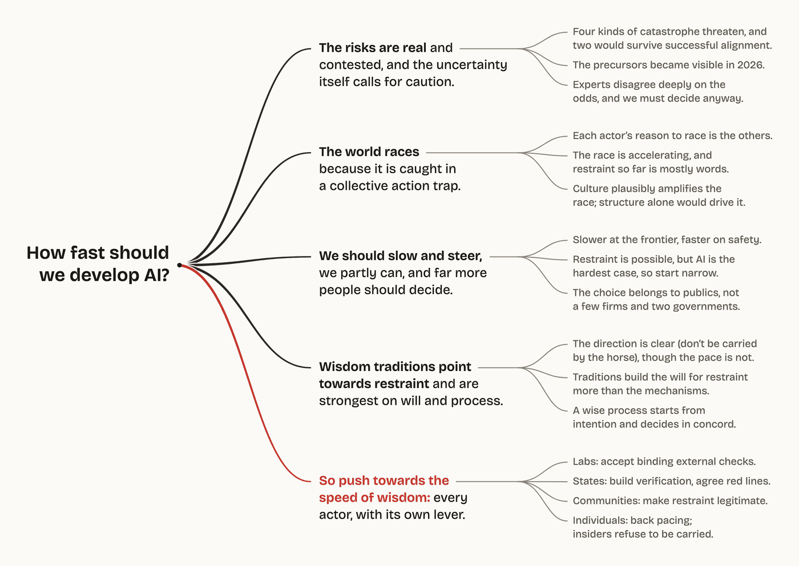

```bash
node bin/render.js ../../../examples/speed-of-wisdom.md --palette wise-ink --font bricolage --out out
```

### Root styles

How the root question is drawn: right-aligned on the dot (the default), centred on the dot, in a light box, or in a thin outline. Use a box or outline when the root needs to stand apart from the page.

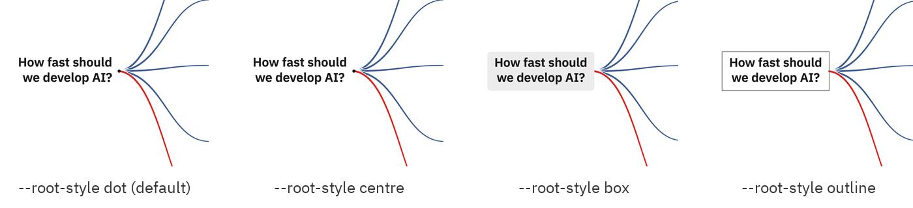

```bash
node bin/render.js ../../../examples/speed-of-wisdom.md --root-style centre --out out
node bin/render.js ../../../examples/speed-of-wisdom.md --root-style box --out out
node bin/render.js ../../../examples/speed-of-wisdom.md --root-style outline --out out
```

### Coggle's curves

Coggle's S-curve for the ribbons and hairlines, over a run long enough to keep its soft corners. Use it if you prefer Coggle's rounder corners; the tree is a little wider.

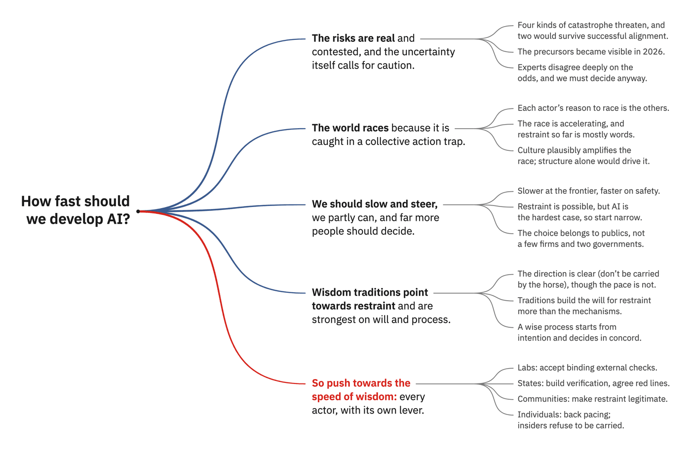

```bash
node bin/render.js ../../../examples/speed-of-wisdom.md --curve coggle --out out
```

### A one-level tree

A root with four questions and nothing under them ([examples/four-questions.md](../examples/four-questions.md)), root centred. Use it for a list of open questions; the root is capped at 1.15× the questions' size so it does not shout.

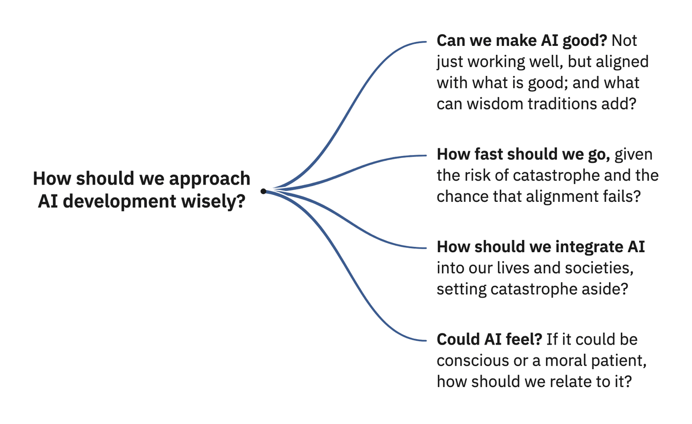

```bash
node bin/render.js ../../../examples/four-questions.md --root-style centre --out out
```

## Coggle (coggle-exact)

Coggle's own look: thick coloured S-curves, a grey root box, Arimo. Use it for a colourful look, or for trees more than two levels deep (it draws every level).

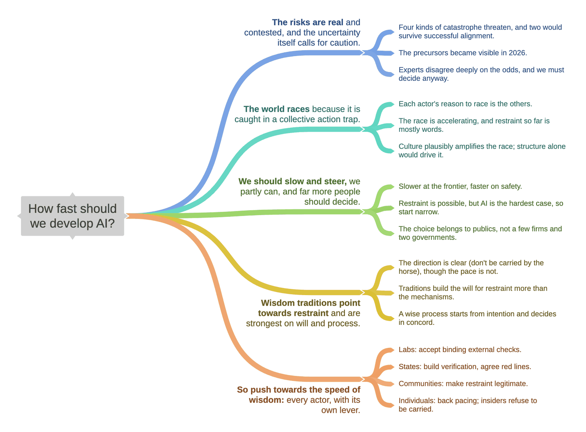

```bash
node bin/render.js ../../../examples/speed-of-wisdom.md --style coggle-exact --out out
```

### Print palette with Bricolage

The Wisdom and AI print colours (teal, ochre, slate, green, seal red on the conclusion) on paper. Use it for a coloured version of a site's palette.

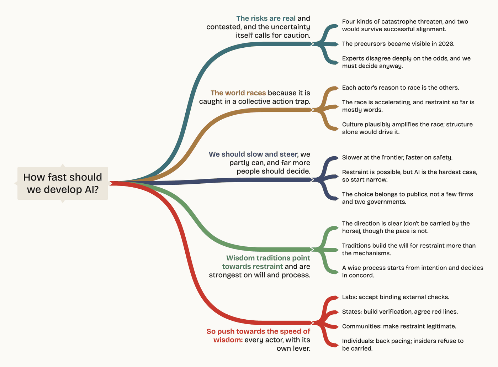

```bash
node bin/render.js ../../../examples/speed-of-wisdom.md --style coggle-exact --palette wise-print --font bricolage --out out
```

### Another font

Coggle's colours, set in Bricolage Grotesque. Use `--font` (arimo, plex, atkinson, bricolage, merriweather, plexmono, quattro) to match a site's type.

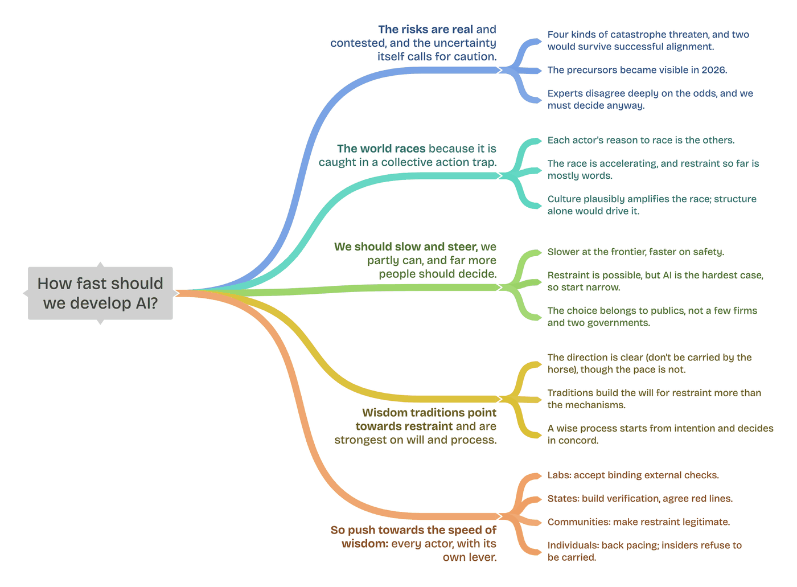

```bash
node bin/render.js ../../../examples/speed-of-wisdom.md --style coggle-exact --font bricolage --out out
```

### Coggle's full run

The root's branches run the full width Coggle gives them, rather than the shorter default run. Use it to match Coggle exactly; the default is narrower.

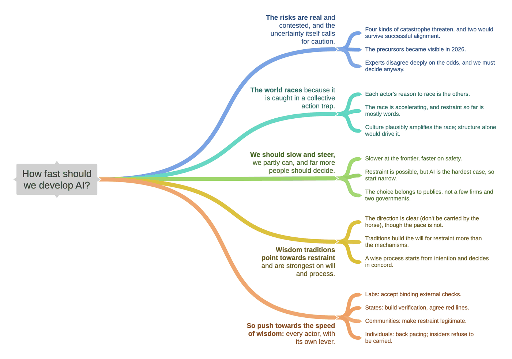

```bash
node bin/render.js ../../../examples/speed-of-wisdom.md --style coggle-exact --root-run coggle --out out
```

## Coggle-thin

Coggle's layout in IBM Plex Sans, branches half as thick, an outlined root. Use it for a quieter page.

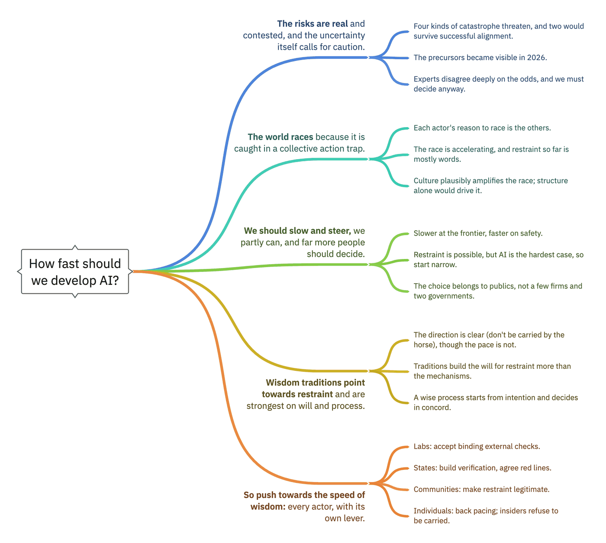

```bash
node bin/render.js ../../../examples/speed-of-wisdom.md --style coggle-thin --out out
```

### Ink palette

Black branches on paper with one red branch. Use it for a sober, near-monochrome version.

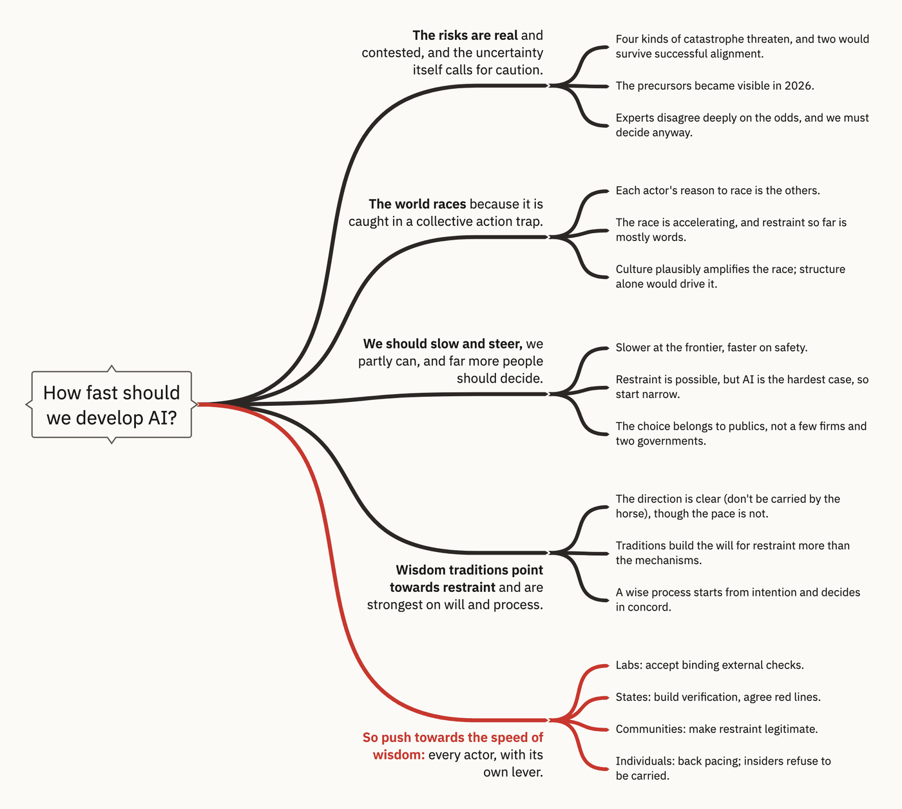

```bash
node bin/render.js ../../../examples/speed-of-wisdom.md --style coggle-thin --palette wise-ink --out out
```

## Dendrogram

Bold root on a dot, dark S-curves to each main point, rounded elbows to its short points. Use it for print, or a sober look.

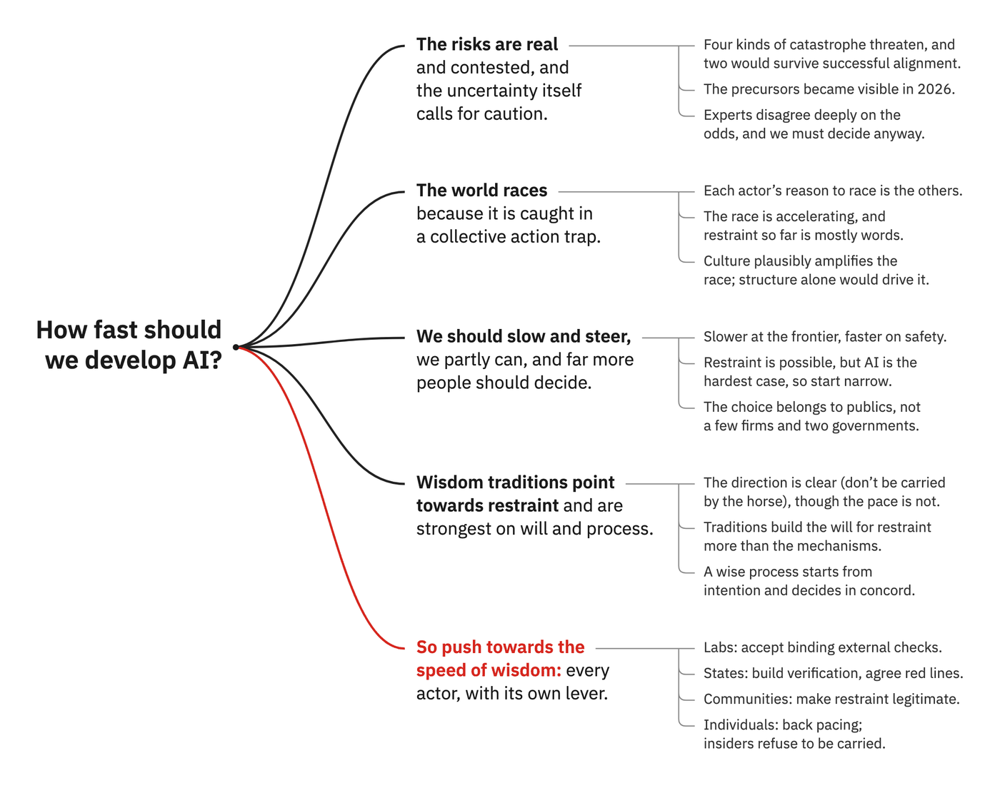

```bash
node bin/render.js ../../../examples/speed-of-wisdom.md --style dendrogram --out out
```

### Coggle's curves

The same with Coggle's S-curve over the longer run. Use it if you prefer the rounder corners.

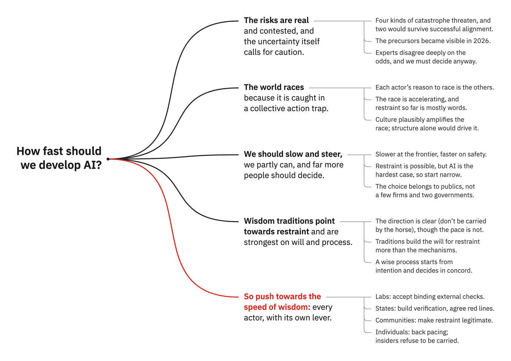

```bash
node bin/render.js ../../../examples/speed-of-wisdom.md --style dendrogram --curve coggle --out out
```

## Lanes

Ribbon's root and ribbons, each main point and its short points on a soft grey band (red for the conclusion). Use it when a branch has many short points and they need grouping.

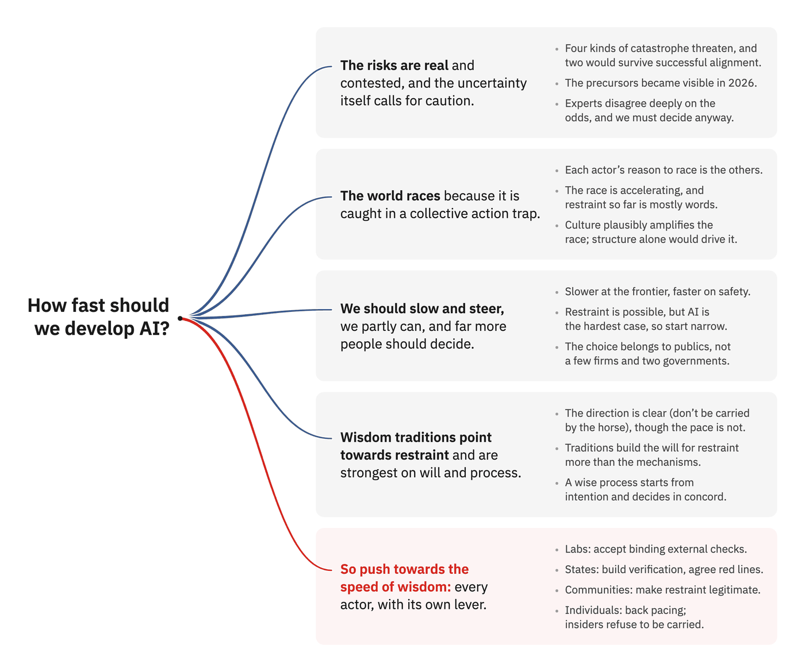

```bash
node bin/render.js ../../../examples/speed-of-wisdom.md --style lanes --out out
```

## Other options (coggle styles)

### Text sizes

`--sizes` sets the root, level-1, level-2 and deeper sizes in px. Choose from the leaf up: here leaves at 15 px, level 1 at 18, the root at 24.


```bash
node bin/render.js ../../../examples/speed-of-wisdom.md --style coggle-exact --sizes 24,18,15,15 --out out
```

### Depth

`--depth N` shows only N levels below the root. Use `--depth 1` for a summary of the main points.

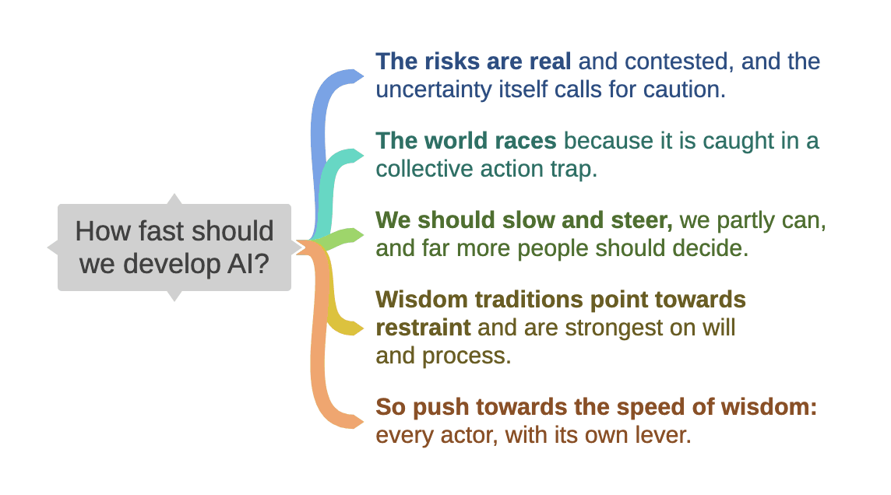

```bash
node bin/render.js ../../../examples/speed-of-wisdom.md --style coggle-exact --depth 1 --out out
```
